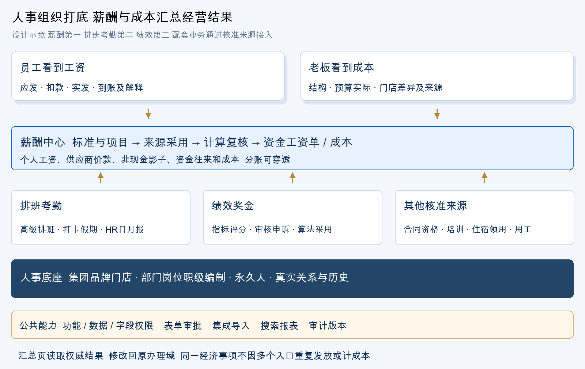
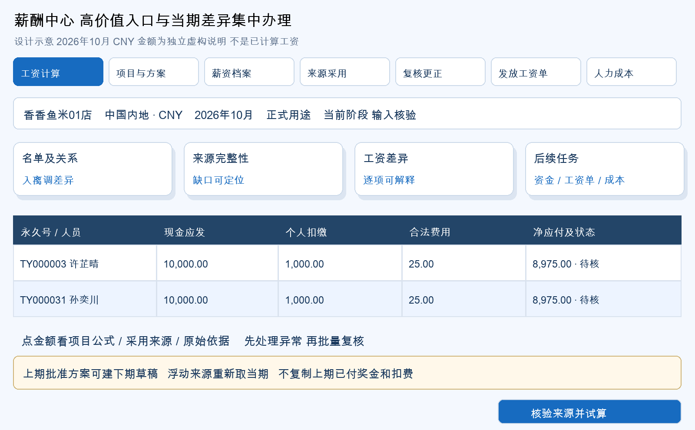
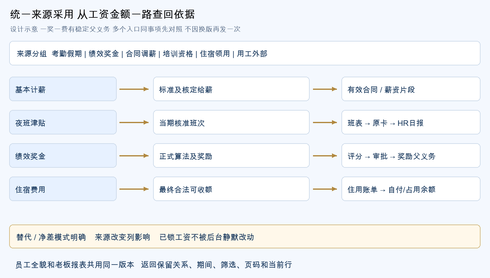
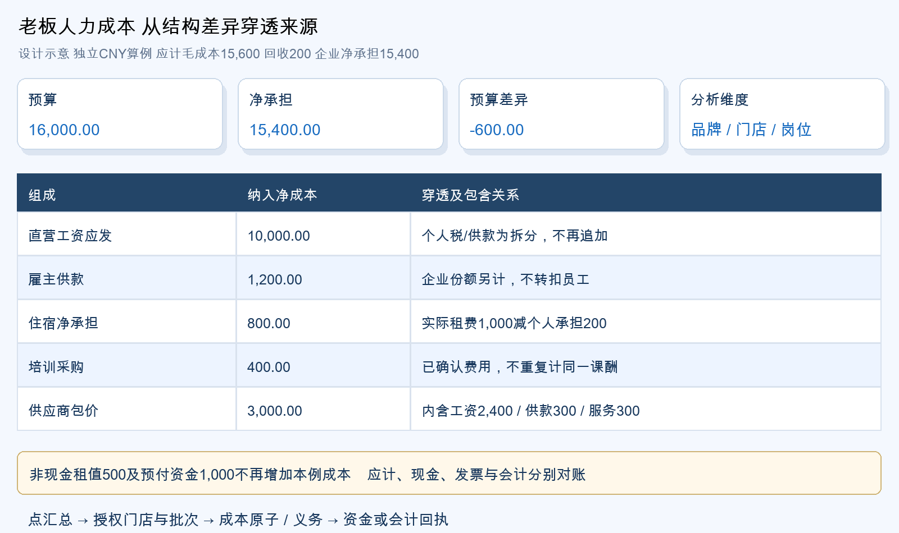
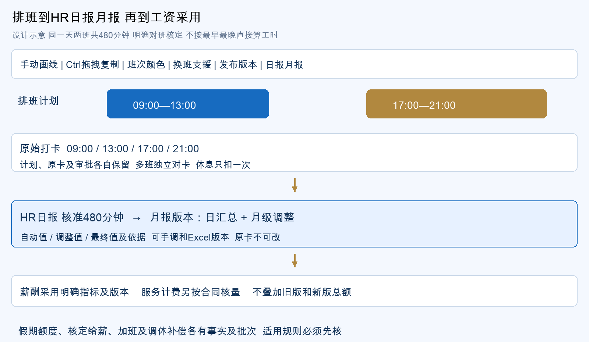
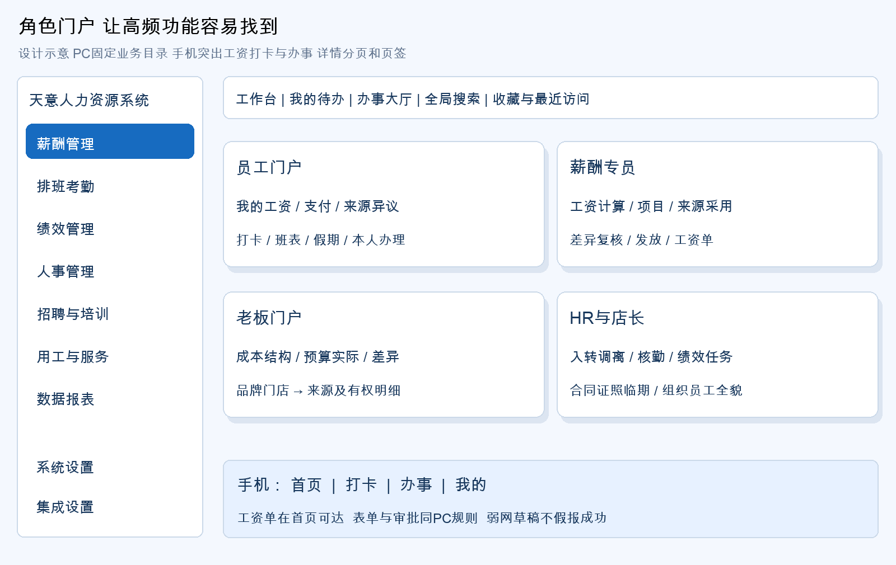
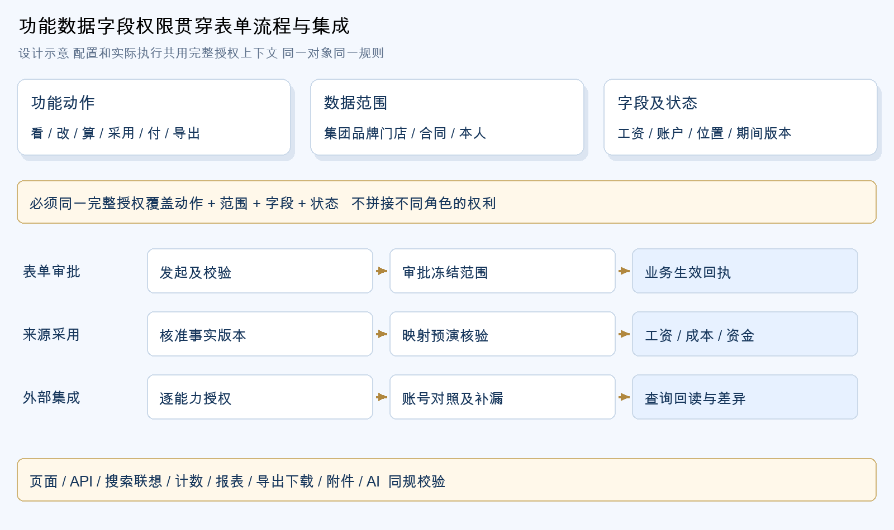

# 天意HR以薪酬为核心的总体功能设计

2026年11月17日  V1.0  产品总体设计

天意人力资源系统服务餐饮集团多品牌、多门店的本地B/S人事管理。员工最终要看清自己应发、扣款、实发、实际收到多少及其依据；老板要看完整人力成本、门店差异和可采取的管理动作。总体以薪酬为核心，排班考勤第二，绩效第三，人事组织与统一权限是所有功能共同的底座。

本稿统一已有V7至V15专项的产品结构、结果口径、页面入口和开发顺序，保留原有功能范围，并把所有可计薪、可计费和可归集成本的结果接到明确入口。它不是把所有事项都变成工资：成绩、证件及流程先完成各自核定，符合政策的待遇、费用和成本才进入对应账册；个人工资、供应商应付、资金往来和管理成本各有依据。

交付为待开发总体规格及虚构开发资料，不代表应用已据此改造。天意集团、香香鱼米和大富烤肉及既有62人均为虚构；客户原表仅帮助理解业务，不导入真实人员。主稿的统一规则优先于旧分稿中概括性冲突，专项未冲突细则继续有效，设计和实际软件验收分别记录。

> 2026-11-17接续：本稿所列高级假期详规缺口已由[高级假期完整规格](advanced-leave.md)及[两地基线](advanced-leave-law.md)补齐。尚未核定的其他地区/假种按模板启用守卫处理，不表示算法已实现。

## 1 产品轻重和完成标准

薪酬好用首先是正确、可解释、可追溯和按期可办，不只是一个漂亮工资表。任何工资金额能回到有效身份、标准、考勤、绩效或其他获批来源；漏项、冲突、税供款资料缺口及修改影响可定位，复核、付款、工资单和更正都有负责人及结果。

排班考勤要能完成餐饮多班次、跨夜、临时支援、换班和人工调整，HR最终能拿到可信的日报月报供算薪。绩效要完成指标、评分、互评、审批、发布、申诉和奖金采用。人事组织、实际关系、岗位职级、合同、历史和权限先一致，上层不能各建自己的员工表。

招聘、培训考试、证照、宿舍、行政领用和供应商仍保留完整基本办理，但优先投入主线稳定性和日常效率。客户启用某项待遇时，其来源和合法采用就是该客户算薪的必要能力，不能因模块整体排后就漏掉费用。开发顺序按依赖与风险推进，不删范围，也不以模拟成功记录代替实际能力。

| 层次 | 首要成果 | 交付底线 |
|---|---|---|
| 共同底座 | 人事组织、永久人、真实关系及统一授权 | 期间与历史一致，三类权限及审批可执行 |
| 第一核心 | 薪酬、法定供款税务、工资发放及人力成本 | 逐人逐项可核，来源采用防重，结果和资金闭环 |
| 第二核心 | 高级排班、打卡、假期、核勤日报月报 | 计划事实分清，版本可调可封，可信结果供薪酬 |
| 第三核心 | 绩效考核与奖金 | 结果审核发布、算法可选、奖励一次采用 |
| 配套业务 | 招聘、合同、培训考试、证照、宿舍、领用、用工协作 | 基本流程完整，涉及工资和成本的接口不能断 |
| 公共体验 | 导航、检索筛选、穿透、报表、集成和消息 | 有权的任务方便找，跨页面口径统一，异常可办 |

## 2 总体架构和模块关系

底层统一集团帐套、品牌公司、门店公司、部门档口、岗位职级编制、永久人员、真实法律关系和有效任职；共享权限、流程、表单、导入、集成、消息、审计及附件。业务模块各自负责原始事实和核准结果，薪酬中心负责明确采用、计算及结果，人力成本中心负责按成本口径归集和解释。

页面分工作台与门户、业务办理、设置和数据报表四类，使用同一事实源与授权。员工全貌、组织全貌、老板驾驶舱都是有权投影及穿透入口，不作为另一份可编辑主档；修改必须回原负责模块办理，不能在每个汇总页面改出不同的工资。

本地部署的核心业务可独立运行，外部平台和银行、税务、供款、招聘、电子签或设备逐连接按能力接入。公司可启用内地、香港或两套算薪体系；每个工资用途、币种、真实关系及资金义务明确，影子测算不生成第二份工资和真实对外申报。

## 3 组织人员和责任主体底座

集团、品牌公司和门店保持上下级管理关系，各层可设部门及岗位；门店是独立经营核算公司，不用部门替代。部门化档口与工作区域档口分开，岗位、职级、技能及证照不混同。部门岗位编制、招聘预占和实际任职占用按人数/FTE与有效期分别核。

永久人员编号贯穿同集团跨品牌、跨店、离职复聘历史；公司入离调段、真实雇主关系、任职、派驻及临时支援分开。同一人多份真实关系可各有合法薪酬，集团人数去重为一人不抹掉第二份工资；普通借调只改工作或成本分配，不自动另造全额工资。

合同雇主、用工/服务接受方、工资付款、扣缴、社保/MPF、实际工作门店和成本承担分别有稳定主体及有效期间。组织调整或平台通讯录变动先对照，不自动建立/解除真实关系。入转调离生效时重核标准、排班、假期、合同及后续工资影响，保留发生时组织版本。

集团HR总监具备既定全集团业务能力，品牌/单公司总监和HR按范围授权，老板按成本分析授权，admin负责配置，demo只在隔离虚构帐套全权。跨无关客户帐套完全隔离；同集团跨品牌历史也依当前授权读取。

## 4 统一事实版本义务和采用

稳定事实标识说明发生了什么，来源版本说明本次核准的解释；奖励或费用父义务说明是哪一项经济事项，采用行说明进入哪个计算，个人/供应商资金义务说明最终向谁结多少。上述对象分开，换版本、改项目名称、换算法或拆批次不产生新的同一份应付。

同一培训奖励通过考试、证照、绩效或人工导入再次送来时，以有依据的来源别名核定同一经济事项，再共用父义务；无法可靠确定的疑似重复进核对，不能仅凭姓名、金额或同日自动合并。工资与服务计费可以分别读取同一工时，服务计费内部及同一奖励资金内部各自控制累计数量/金额。

批准冻结来源、规则、范围及修订，执行时重验资格、期间、职责和余额。更正保留原事实和旧结果，替代或净差均声明模式；已确认工资、银行、申报、供款、发票和会计分别按其权威状态办理，不把“已审批”当所有结果完成。

## 5 薪酬中心和每月操作路线

薪酬首页固定显示“工资计算、工资项目与方案、薪资档案、来源采用、复核与更正、发放与工资单、人力成本”，两地薪税供款按启用体系显示。当前期间卡列应办人数、来源缺口、待复核、应付、支付异常及未结更正，点击进入带范围的清单，不只给不能解释的汇总数。

建批次选择公司/工资组、体系、用途、币种和期间，依次完成名单、来源核验、试算、差异、复核确认和后续任务。名单按真实关系及有效片段形成，入离调、跨品牌、兼职及派遣法定组件有清楚理由；不按当前花名册静态人数猜上月名单。

例行月份可从已批准方案及上期设置生成下期草稿，自动收集获准来源、比对新增离职/调薪和异常，只让经办集中处理差异。固定输入可按有效期沿用，浮动输入重新取当期来源，不复制上期已付奖金和扣费；批量核验/采用按授权及规则执行，正式确认和资金动作仍按既定流程办理。

工资计算页按人员项目表分页，固定工号姓名及关键合计，支持按异常、来源、部门岗位、门店、工资差异和状态过滤。选中一人可展开项目、公式、来源、调项和历史，不把全部公式明细摊成长页；批量操作先预演范围，单人异常不能被总额正确掩盖。

复核确认后分出个人资金、供款税务、工资单和成本任务；各自支持负责人、状态、回执和重试。所需来源或适用规则缺失的行有具体原因及办理入口，无关供应商缺票、提醒未读或非计薪业务未办不自动卡住无争议应付工资。

## 6 预置工资项目和客户启用

预置目录覆盖常见固定薪、时薪计件、餐饮津贴、奖金绩效、假期给薪、加班、补发追溯、个人合法扣项、税供款、企业承担、非现金待遇及统计基数。客户按公司、体系、工资组及方案挑选、改显示名、映射标准和发布有效期；目录存在不会自动计发，未启用不为每人生成大量零行。

适用法定义务通过独立守卫保证：客户可以不选不适用的业务项目，不能取消已经适用的税、供款或法定保障来让工资试算通过。缺规则、缺材料、不适用和已核准零值分别显示。两套同义或替代项目同选时提示明确叠加依据，不能固定工资与全额时薪默认双发。

目录按现金应发、个人代扣/合法承担、雇主成本、报销及往来、非现金影子、计算基数/展示、代发资金及采购服务分账。服务费、房东租金、培训采购和工资非现金税务值均可在薪酬/成本中心穿透，但不会因此都计入员工现金工资。详细预置条目见附录B及配套结构化目录。

经济补偿、遣散费、长期服务金、代通知金和未休假结清另有现金性质及支付账册；普通工资、所得税、社保、MPF、平均工资、最低保障和成本科目逐域核定，不能因为同属本期现金给付就全部纳入普通工资及每一种法定基数。雇主商业意外险和香港适用的雇员补偿保险分别建项，避免可选商业保险掩盖法定义务。

| 项目家族 | 主要准备内容 | 启用时必须核定 |
|---|---|---|
| 薪资标准 | 基本、岗位、职级、技能、时薪及计件 | 同义替代、期间片段、折算及单位 |
| 餐饮津贴 | 全勤、夜班、高温、交通、餐食、支援等 | 准入、次数/工时来源、政策及成本归属 |
| 奖金绩效 | 月季年、门店经营、绩效、提成及奖励 | 正式算法、奖励父义务、分配及发放期 |
| 假期及加班 | 年假病假等给薪、各类加班及补偿 | 地区法定资格、平均基数、唯一补偿去向 |
| 补发及扣结 | 追溯调薪、纠错、依法费用及退款 | 来源净差、合法依据、已结及占用 |
| 两地法定 | 内地税社保公积金、香港MPF与雇主申报 | 主体、资格、有效版本，不能套全员固定比例 |
| 福利与成本 | 住宿、保险、培训、领用及服务采购 | 实际承担、包含关系、税务及现金性质 |

## 7 公式参数触发器和AI扩展

项目用稳定编码引用，金额、工时、天数、次数、比例、布尔和日期分类型。按输入及资格、收入分段、法定口径、税供款、合法税后调整、资金及成本阶段执行；静态检查全部分支的依赖、缺项、循环和单位币种，运行明细显示命中条件、取值及舍入。

提供可视条件、查表阶梯与高级公式两种编辑方式，共用版本定义，支持自动补全、依赖图、样例对比、影响预览及审批发布。金额用精确十进制或等效有理数，原始分钟不先转不精确浮点；标准、法定表、代码和人工调项都在冻结快照可复现。

触发器可在关系生效、来源核准、采用、计算、更正等明确事件生成任务或候选，不能由考试发布或设备打卡直接发钱。自定义代码在能力受限的隔离执行器运行，输入输出声明、版本固定、资源限额和独立复核沿V8；AI负责起草解释和辅助预演，正式采用、审批及执行仍由当前权限和业务守卫裁决。

## 8 所有结果的统一采用入口

“来源采用”页按考勤假期、绩效奖金、合同调薪、培训资格奖励、住宿福利费用、行政领用、供应商/派遣和外部核定分组。每行列人员关系、公司、来源根及版本、业务期间、目标工资项目/成本项、数量金额、依据、已采用/未用/受阻及去往批次，点击回原办理。

办理顺序为取候选、范围核对、预演、审批、采用生效和后续更正。依据分尚未核准、已核准待采用、已占用/已采用、受阻、需更正，不能把已审核培训记录直接当奖金已付。普通模板映射与高级公式调用使用相同来源契约，不允许从报表总计重新导入一笔同样奖金绕防重。

低频一次性奖励可逐项复核，周期标准工时和已核准参数可由授权计划批量形成候选、自动校验并按配置采用；自动模式有明确服务身份、范围和失败清单，不要求每月重复手填相同核定值。配置批准能覆盖哪些例行采用、哪些变更必须重审要可读，不能用“全自动”绕过职责和版本守卫。

同一事实可被多个计算项引用，但最终应付额度由奖励/费用父义务和明确分配控制。替代新值与差额模式互斥，来源已变更先列影响；已锁工资不被后台事件偷偷改动。已自付的住宿费、已由供应商承担的费用及已冲回项目共同核净余额，不能再向个人扣一次。

## 9 手工调整导入和追溯更正

有权限可创建输入修订或调整版，冻结父版、范围、原自动值、替代值或增减量、理由、凭据、有效期及批准。调项优先级明确，重算时必须保留、冲销或重新审批，不能“最后写入胜出”；人工可改获准业务值，不能取消法定适用、原始事实、主体或已付回执。

外部核定工资、外部月报与系统计算分开来源，可在无日明细情况下按复核规则采用，明确缺明细；不伪造原卡、公式或审批。外部版与本地版对同一范围/指标只替代不叠加，首次外部基线可无父版，后续明确父版和替代范围。

追溯调薪、补卡、绩效申诉、证书撤销、住宿退款及主体纠错先模拟影响。未锁批次重算，已锁建立更正版/差额任务，已付则按原父义务核净应补或应退；不会把旧全额和新全额再发一遍。工作期、工资期、支付期、税供款期和会计期分别记录，不因更正一律回写同月。

## 10 发薪工资单申报及关账

工资确认冻结计算结果，合法费用扣结在核准确认时留唯一扣结记账；个人净工资付款、税务申报与缴税、供款申报缴付、工资单发布及会计结果各自留状态和回执。银行失败不让已扣结住宿费再成为新欠费，供应商收到代发资金不代表员工收到工资。

支付按稳定个人资金义务控制普通发薪、补发、代发路径及退款，未知占用先对账，不盲换渠道重付。内地、香港及具体主体分别处理，影子批次不能付款；适用法定义务资料待核需要责任人及处理路径，不把未连接银行或政府接口伪装为自动成功。

员工“我的工资”显示已发布版本、应发扣款实发、支付状态、项目解释和本人异议。发布不等于已付，本人已读不等于放弃异议。关账按公司/关系/期间/项目及各域状态管理，关账后仍可留受控更正；局部争议与非工资事项不能一键冻结全集团应付工资。

## 11 老板的人力成本中心

老板默认看集团、品牌、门店及成本中心的预算、应计实际、现金已付、单位成本、结构和差异。工资、雇主供款、福利培训、外包及其他人力服务组成可解释；HR部门自身管理费用也可归本部门成本中心，具体门店工资按实际受益及承担分配，不集中误记到一个人事部门。

建立成本包含契约：直营工资按应发及明确雇主承担归集，不以净薪再加个人税供款重复累计；供应商包价已含的工资供款只作组成拆分，不在总价之外再加一次。房东租金、企业福利及员工回收款分清总成本、回收与净承担；住房税务租值不再追加现金或真实租金成本。行政物品采购、领用、内部调拨按确定计量时点和归集政策处理，同一件物品不采购时和领用时各全额计费。

现金发薪、预付供应商和内部转账是资金流，不直接再造费用；确认服务、发票及会计期间分开。费用分摊总额守恒，历史发生组织与按当前结构重述分别显示；缺财务回执时可显示管理口径及待对账，不标已正式入账。

人均、FTE、出勤小时及营业收入比等指标带明确定义、分母、期间和币种，人数与关系数不混。收入指标来自授权经营系统/文件及确认版本，缺源不置零或算无穷比例。老板汇总权限与个人工资明细分开，点总额只能看到有权明细，不能通过小计、筛选差值或导出绕开字段授权。

## 12 高级排班的主操作

以人员/班组/岗位需求和日期时间轴安排工作，多班、跨夜、休息、门店支援及技能资格同时校验。手工画线、拖动调整、Ctrl拖拽复制、批量复制、周期生成和Excel导入保留，复制目标重新核关系、日型和工时，不带原审批、打卡、工资或已确认结论。

标准班次颜色可配置，页面以颜色加文字区分，缩放与分页按人员和日期管理。拖动前后预览具体时间、休息及冲突；多人跨分页复制显示明确人员映射，不把缺行挤到另一人。发布前做规则和版本校验，已发布班表更改走新版本及影响通知。

换班互换、替班、调班、临时支援和到期回归有个人及主管表单，批准与实际发布分别可见。岗位资格、容量、休假、同人多关系时间及法定工时限制按有效规则重验，不能靠多账号或跨公司绕过。排班是计划，实际工作由打卡及核定形成，不自动把计划满勤送薪酬。

## 13 打卡核勤和HR日报月报

本系统PC手机打卡及钉钉、飞书、企微、考勤机/文件原卡进入不可改收件箱，按平台企业/设备命名空间及发生时映射匹配。原发生时间、接收时间、迟传、设备漂移、补卡和可信级分开；多源同事件有依据关联，不能按同秒同人粗删或把计划时间补成实际卡。

多班独立对卡、跨夜按规则归日，休息、请假、加班和异常核定有可解释来源。日报和月报是HR最终核对面，支持权限内手调、Excel导入/导出、父子版本比较、复核封存及工资采用。月级补调不伪装成日明细，重汇总保留/冲回/重审调项，原始卡和旧报表不覆盖。

日报列计划、实际、异常、假期、核定工时及采用状态；月报列日级汇总、月级调整、最终指标、版本和来源模式。点数字可穿透某日某班，供应商只见合同授权服务工时。缺卡、无班、未映射、数据缺页和未确认分别待办，空接口响应不等于零出勤。

## 14 高级假期与计薪接口

总体将假期列为考勤薪酬必要能力：假种及地区规则、适用人群、资格/年资、计量单位、发放批次、预占使用、调整、结转到期、取消冲回、离职结清与给薪基数均须有对象和责任。法定年资、集团承认司龄、实际雇主连续关系分别取证；门店调动不随意清余额，跨雇主转移另核依据。

额度按来源批次和有效期间记台账，发放、预占、使用、释放、结转、过期及补偿分别有凭据。同一请假申请经批准才核销相应额度，待批按政策预占；撤回或改期重核额度及已封勤影响，不能只把余额数改大。半天、小时、跨班休息和跨月分段按所选制度处理，不默认所有假都以自然天扣。

员工可发年假、病假、调休及企业自定义假种，附件和证明分权；主管看必要资格及时间，薪酬看核定给薪指标。病假工资、年假给薪及未休补偿读取V8适用地区资格与平均基数；加班转调休保存原工作事实及唯一补偿分配，部分现金/部分调休须有明确份额，不双补同一部分。

PC余额台账、批量发放和规则编辑，手机余额/申请/进度/异议都与员工全貌相连。V7原假期附录仅列24项范围，未提供同粒度独立详规；本稿补齐总体对象、办理链和准入要求，复杂资格、特殊假种及地区算法在开发前继续细化并用边界样例验收，不能据页面已列出宣称高级假期全部完成。

独立假期自动化未就绪时，可先用经核准的外部假勤/余额基线，标来源及无日明细并独立核定权益，支持当期合法算薪；不能为等假期自动化完成而无限期停发无争议工资，也不能用外部基线声称自动发放结转已实现。

## 15 绩效到奖金的完整线路

绩效设置包括周期、人群岗位、指标库、目标权重、评分标准、校准及审批、结果等级和奖金规则。支持简易结果/KPI/门店经营考核，保留自评、互评、上级评分、审核发布、成绩通知及申诉；改成绩留版本，已读不替代本人知情或审批。

经营数据、任职职级片段、门店责任范围及培训资格等按明确口径取值。两套奖金算法可并行试算比较，正式采用按方案、对象和期间选定，另一套不自动再发。结果发布与奖金审批、薪酬采用和银行发放分开，成绩更正先列影响再净差处理。

绩效首页提供待评、待审、差异、发布及奖金采用，个人可看本人历史和申诉，店长看获权团队。考核成绩或培训纪律不会未经有效制度就自动罚款；客户必要的奖金结果可从经复核的外部表采用，但要标来源及不能和系统算出的同奖重复发。

## 16 配套模块的最低完整功能

配套模块的页面可简洁，基本办理和个人历史必须完整。任何明确影响薪酬/成本的结果都用同一采用入口，纯履历/提醒只进入全貌及待办；客户关闭某模块时，历史、未结义务和被依赖的规则仍可合法处理，不能直接删除。

| 模块 | 必备基本办理 | 与工资成本的交接 |
|---|---|---|
| 招聘 | 需求编制、候选、面试Offer 入职转换和导入 | 核准入职标准；招聘服务费归相应成本 |
| 人事合同 | 签续变解、附件证据、结构化条款、到期提醒 | 已核工资考勤条款分段生效，签署不直接发薪 |
| 培训考试 | 课程计划、签到带教 题库试卷、阅卷复核补考 | 奖励/持续资格津贴与采购费用分路 |
| 证件证照 | 门店和个人证件、要求核验、续期到期提醒 | 岗位准入及待遇资格，有依据费用另采用 |
| 宿舍 | 房屋卡片床位、入换退宿、维修抄表账单 | 企业房租、福利、个人费用及工资扣结分账 |
| 行政领用 | 用途设置、采购入库、领用出库 退回更正和统计 | 福利用途可配，费用不默认扣个人工资 |
| 用工协作 | 供应商资质合同、订单派驻 工时对账、发票与资金 | 员工法定组件、服务价款和代发各核责防重 |

派遣用工单位依法承担的加班费、绩效奖金及福利等按实际职责逐组件核定，关联真实派遣关系和V8资金义务，不为付款造客户雇佣。V15该路径优先于V8旧“受托才可处理”的泛化表述，法定职责依据与代发委托分别保存；供应商账单确认不能代替个人发薪证明。

## 17 统一导航和角色门户

PC业务导航依次为薪酬管理、排班考勤、绩效管理、人事管理、招聘与培训、用工与服务、数据报表。上方公共区放角色工作台、我的待办、办事大厅和全局搜索；底部单独保留系统设置与集成设置，权限审批配置和外部连接都有固定入口。角色只显示有权任务，demo可看全目录，隐藏不是唯一权限防线。

人事花名册为人员列表唯一名称，员工全貌为其个人详情及所有模块的穿透目的地；人事组织架构含树、网和部门/岗位维度，组织全貌为节点详情，不另挂一个同义全景菜单。招聘、培训考试、证照、宿舍和行政领用保留明确二级任务入口，可全局检索、收藏和从本人门户直接办理。

员工首页突出我的工资、打卡、班表、假期余额及待办；手机常驻首页/打卡/办事/我的，工资单在首页直接可达。薪酬员首屏工资计算及来源缺口，排班员首屏班表与异常，HR首屏人员办理和到期风险，老板首屏成本，供应商首屏合同工时及对账。授权改变后门户及时重算，旧链接仍在服务端重验。

## 18 模糊搜索筛选与保存视图

全局检索支持功能名称及常用同义词、永久号/历史业务号、授权人员姓名、公司门店、合同及单据号；姓名包含、拼音/首字母可作为可选索引，历史号有多个来源时显式选公司期间。同名只列有权候选，不据模糊命中自动合并人员或建立关系。

各列表提供关键词模糊匹配及结构化过滤：公司品牌/门店、部门岗位职级、人员状态、供应商合同、业务期间、金额范围、异常类型和办理状态。支持组合条件、空值/未配置与零值、批量筛选、保存个人/共享视图及重置，筛选摘要始终可见，当前页小计与查询总计分开。

功能搜索按当前权限返回入口，数据检索先授权再检索；受限字段不进入普通索引、提示词、联想、匹配原因、排序和计数。保存视图存条件及列配置，不存永远有效的权限快照；复用或分享时重新核每人范围，导出不可借保存视图扩权。

## 19 页面单据和员工全貌穿透

统一穿透上下文携带稳定对象、关系、观察日期/业务期间、来源版本、当前筛选及返回位置。工资金额可依次到项目公式、采用行、已核日报/奖金/住宿费用、原始证据；老板成本到来源结构、公司门店、批次及付款/会计状态，支持返回时保留原行、页码和筛选。

员工全貌分个人与多关系概览、人事履历、合同、班表考勤、假期、工资、绩效、培训考试、证件、住宿领用及申请历史页签。每页同一永久身份和授权期间，既能看跨品牌经历，也不因一个住户或供应商链接拿到完整档案。组织节点按同一日期显示成员、岗位编制、人员流动及成本口径。

表单可点关联人员/公司/合同/班段/账单，看只读摘要或有权详情；有权修改则明确跳到原办理页。无权、对象失效、版本已替代和附件缺失显示适当原因及可申请的路径，不把历史单据强行跳到当前同名员工或最新工资。抽屉展示一项任务摘要，复杂编辑进入独立页，不嵌多层无限滚动。

## 20 统计报表和客户自定义

预置工资逐人逐项及差异、发放失败、两地税供款、考勤日报月报、假期余额、奖金采用、工资成本结构、预算实际、门店对比、供应商应付实付、合同证照临期和人员流动等报表。每个指标有名称、单位、粒度、期间、币种、状态、分子分母及来源；能回答问题并穿透，而非只给通用柱状图。

自定义报表选择授权主题、维度、指标、列顺序、筛选、分组、排序、小计/透视和图表，可保存私人或共享模板及定时生成。客户可在受控表达式中组合已授权指标，预演数据范围与执行成本后发布；普通报表编辑器不开放任意SQL和跨租户关联。公式改变产生新版本，不静默改已发报表定义。

工资行、考勤日、多个合同和多证书是不同粒度，多表先按明确键汇总再关联，防一人多证书把工资乘几倍。跨币种分别显示，折算留汇率版本；历史组织和当前结构重述分别选。摘要权限、明细权限及敏感派生指标分别核，受限字段不能通过计算、筛选差值或小样本组合反推。

异步导出和定时报表以任务发起及执行时的有效授权控制，生成和下载再次核范围、字段、失效及撤销；附件短链、打印和API同规。大范围查询有可取消进度和错误说明，缓存键带授权/来源版本，权限撤销后旧缓存不可继续展示。

## 21 系统设置中的三类权限

系统设置独立页面管理操作人员、角色、功能动作、数据范围、字段规则、有效期、代理及审计。功能权限覆盖查看、建改、导入、发布、计算、核定、调整、采用、复核、付款、导出和配置，不能只控制菜单可见。数据范围可按集团品牌公司、部门、门店、供应商合同、本人及明确授权集合；字段分可见、可写、掩码及可用于汇总/计算。

一次请求必须有同一完整授权覆盖动作、对象范围、字段及状态，不能拼甲角色动作与乙角色范围。高权限服务、定时任务、公式、AI及导出也带明确身份和最小任务范围。原卡、工资账户、位置证据、银行凭据与个人证明独立字段授权，非业务admin不因能配置就自动读全部。

设置页能模拟“某人对某公司某单据某字段能做什么”，列允许或拒绝的依据、角色、期间和限制；模拟不能更改业务。角色/规则变更可比较影响并审批发布，撤销即时阻断新访问，历史已实际执行保留审计。集团总监、老板、HR专员、店长、员工、供应商及admin的默认模板可复制，但复制不带旧密钥或额外数据范围。

## 22 表单审批设计和执行闭环

系统设置提供表单目录、字段及校验、流程设计器、规则分支、审批人解析、代理回避、版本发布、仿真和运行异常。表单类型包括入转调离、合同、调薪、排班/假期补卡、绩效奖金、培训资格、住宿领用、供应商对账和资金等，员工可从办事大厅/对应模块/本人记录发起。

表单草稿、提交、审批、业务生效、通知及外部回写分开；审批必须绑定业务处理器及所批准的版本和范围。批准调薪后还要实际生效片段，批准退宿后还有实际交接，批准付款后还有银行回执；处理失败保留原批准并待重验/重试，不伪造全部完成，也不重复执行已生效部分。

缺审批人、离职、超期代理、循环分支和必填缺失在设计仿真/提交执行暴露，不能自动跳过通过。运行实例冻结流程/表单/业务快照，变更关键金额、日期、对象或附件触发重新核准。跨平台审批选定唯一权威，平台结果和天意效力分别跟踪，撤回和更正有补偿路径；站内消息、多渠道投递、已读及业务办结不混。

## 23 独立集成设置和数据出口

集成设置按连接账号及能力管理钉钉、飞书、企微、考勤机、招聘电子签及财务税供款等适配，不用一个“已连接”绿灯代表所有读写。人员组织对照、原卡、平台核勤结果、通知待办、审批回传和工资/成本交换各自范围、方向、版本、权限、批次水位及异常对账。

V15已核的接口等级继续保留：钉钉部分为历史官方规范且现行准入待核，飞书按资源和employee_type核定，企微添加卡/补卡有自建应用及审批副作用限制，设备按型号协议。连接及token不建立雇佣、不证明已发薪或供款；没接口或无授权时可用受控文件及人工回执完成内部办理，但不标真实已直连。

本地运行与外部网络授权分开，回调验签入箱、出站发件箱、稳定业务ID、结果未知先查询及周期对账通用。云回流识别本方写出别名以防同步环，原件与核定版本不混。工资成本向财务输出明确金额性质、期间、科目及分摊；财务接受、记账、银行及税供款回执分别回传，导出不当已入账。

## 24 Excel文件和历史数据接续

所有模块使用统一导入中心：选择业务模板和模式，暂存、列映射、身份关系、期间单位、重复与依赖预检，差异预览、授权复核后生效。支持XLSX及补充CSV，PDF/图片只提取待核草稿；宏、外链和文档内指令不执行，原凭据不被转换副本冒充。

缺列、空白、零、明确清除和不适用分开，局部更新不清他店资料；支持预检错误下载、按明确成功组续跑及幂等重导。预演批准冻结文件、映射、范围和目标修订，来源变化使旧批准失效；跨环境按集团编码、永久号及稳定业务号匹配，不硬编码本机关系ID。

旧两套人员、工资及供应商模型先盘点映射、冲突和未结义务，再按域迁移。只读历史查询保留，不能把旧同步自动建人、计划时间当原卡或失败当空成功直接带入新架构；已有可用界面及逻辑经理解、测试后复用，不用展示页替代真正核算。

## 25 界面一致性和日常操作效率

蓝白金主题配适度阴影和清楚层级，科技感通过排版、状态与交互表达，金额及表格可读优先。PC固定上下文及主操作，列表默认20行可切50/100，详情分二级菜单/页签，长表列冻结、列选择、密度、筛选摘要及键盘操作；状态有文字和图标，不只靠颜色。

高频工资计算、工资项目、排班、考勤日报月报、奖金采用、权限及流程均能从角色首屏或二级任务进入；功能搜索、最近访问、收藏和待办深链帮助找入口。保存后给明确结果及下一步，批量操作预览影响并保留返回位置，失败显示哪行、为什么、谁处理，不只弹“操作失败”。

手机优先当次打卡、班表、工资、请假调班、补资料和审批，复杂规则、全月表格及批量配置优先PC。定位/相机/网络能力不可用提供获准替代，弱网草稿与服务端已接收分明；手机与PC同对象同权限同校验，不做独立手写的一套工资。

## 26 本地部署运行审计和扩展

按当前本地B/S工程逐模块整合，人员、权限、采用和关键余额有统一事务权威，明确领域接口及事件；先保证统一主档和结果一致，不为页面数量把每模块拆成互相复制人员的独立系统。历史明细可受控读取，但不能各库各写一份主身份和已结余额。

后台任务具有范围、来源修订、幂等键、超时重试、未知结果、断点及人工接管；业务和事件同事务提交，查询缓存或通知不是资金权威。运维可见任务健康及错误类别，不默认暴露个人工资、银行账号或密钥。备份恢复演练需核人员、历史版本、累计余额及任务水位一致，不只证明文件能解压。

标准API和AI接口以明确服务身份读取授权冻结数据，字段和数据权限与页面一致；模型建议只生成草稿/解释，工具调用通过业务服务，不能直接写数据库、绕审批或取得另一帐套信息。扩展包版本、测试样例、依赖和资源预算可审计，停用只影响未来启用，已使用历史可复现。

## 27 开发先后和上线准入

第一阶段先做组织身份/关系、三类权限、版本、审批执行及来源采用公共底座，同时打通一个真实可操作的薪酬闭环：考勤或合法外部基线、工资标准、试算解释、复核、资金任务、工资单和成本。主线功能以当前工程实际验证决定完成，既有模块是否能复用单独记录。

第二阶段把高级排班、多班打卡、假期额度及HR日月报做到可用可核，并完成工资项目目录、两地适用规则、公式/扩展及来源更正；客户当期必需的奖金、福利和派遣组件在该阶段一并接入，不能带缺口正式发薪。绩效全流程随后与奖金采用完整验收，配套业务按同一来源接口逐步升级。

第三阶段完善辅助模块操作、跨平台和设备的已授权连接、报表自定义及批量体验。顺序表示投入重心，不表示可以延期适用法定义务、客户必需来源、三类权限或原承诺基本功能。没有可靠容量、联调和回归证据时不编人天或保证某晚全部上线；每个阶段以端到端验收结果过门槛。

正式工资及客户验收须逐人逐项、来源/公式与差异、工资/成本勾稽、同源防重、权限绕行、失败重试、更正回执和恢复一起通过。高优先级缺陷未解决不能用更多低优先模块数量抵消。辅助模块基本流程可简洁，但错误不能污染主档、工资或成本。

## 28 总体验收与已知细化项

用六条任务链验收：员工查工资并提出异议；薪酬员结算上月；排班员画班至HR确认月报；店长提交绩效至奖金采用；老板从成本差异穿透到来源；管理员配置权限/审批/集成并验证实际执行。每条同时验证PC手机、角色交接、版本及错误恢复，不能只录一段全绿演示。

V7高级假期24项需要继续细化到地区算法和额度状态；V8至V15待开发规格、平台准入及外部实连状态继续分开登记。客户真实规则、税社保供款资格、银行和政府接口授权不能用虚构演示替代。本轮将功能、入口、来源、账册及验收统一，具体实现仍须按专项及本稿逐项开发与测试。

总体交付包含主稿、薪项预置目录、页面与联动目录、模块来源采用契约及独立模型核对。附录记录最终计数和检查范围；结构文件全部标待开发，不导入应用、不发送消息或真实执行工资与支付。人事底座、两大核心和公共体验任一有断点，都应能在此目录定位到负责对象、页面和验收。

## 附录A 总体验收场景

以下均为待开发验收，F为底座，W为工资，T为排班假勤，K为绩效，C为成本，P为权限，U为体验，I为流程集成及接续。

| 编号 | 场景及操作 | 必须结果 |
|---|---|---|
| F01 | 集团品牌门店各建部门岗位 | 管理公司与部门档口分清，主体及期间可核 |
| F02 | 同人跨品牌入离复聘 | 永久人号不变，真实关系及公司经历分段 |
| F03 | 同人两份真实雇佣 | 人数去重但合法工资独立，不被过度去重 |
| F04 | 临时借调及成本分摊 | 不新造全额工资，工作与承担期间可追溯 |
| F05 | 组织改名调父级 | 稳定ID及历史版本不变，不改旧工资归属 |
| F06 | 人员同名或旧号复用 | 候选受限核对，不自动合并或建雇佣 |
| F07 | 岗位职级月中变更 | 按生效片段取薪资资格，不套月底标准 |
| F08 | 公司启用CN/HK两体系 | 批次用途币种明确，同工资事实不双发 |
| F09 | 岗位部门编制和招聘预占 | 额度占用交接不双计，FTE与人数分列 |
| F10 | 服务退场和法定雇主离职 | 事件分别办理，保留历史和未结义务 |
| F11 | 点击组织图或员工全貌 | 按相同身份日期授权穿透，不另改汇总主档 |
| F12 | 合并纠错或主体变化 | 预演下游影响，已确认历史更正不删除 |
| W01 | 薪酬员进入工作台 | 计算、项目、来源、发放工资单及成本清楚可达 |
| W02 | 选未启用预置项目 | 仅模板存在，不对全员自动计发或造零行 |
| W03 | 客户关闭适用法定项目 | 守卫阻断或转核定，不以勾选取消义务 |
| W04 | 固定工资与全额时薪同选 | 核叠加/替代，不能默认双发 |
| W05 | 资料缺失不适用及核准零 | 分状态处理，不把缺值都当零 |
| W06 | 多级公式或循环缺项 | 类型依赖校验并列路径，不能静默部分成功 |
| W07 | 代码AI扩展计算工资 | 冻结输入隔离执行，不能绕法定/权限守卫 |
| W08 | 考勤V2替代V1采用 | 同事实更新或净差，不加新旧两版总量 |
| W09 | 一奖多入口再次送入 | 有依据关联同父义务，疑似重复核对不双发 |
| W10 | 手改项目后重算 | 保留/冲销/重审调项，不最后写入胜出 |
| W11 | 无日明细外部核定工资 | 明确外部基线经复核，不造原卡公式 |
| W12 | 月中调薪及跨期补发 | 生效分段，工资支付税供款会计期分开 |
| W13 | 非现金住房或资格影子项 | 可供法定口径，不增加同额现金实发 |
| W14 | 个人税供款及雇主承担 | 应发净额拆分，企业份额不转扣个人 |
| W15 | 住宿自付后再工资采用 | 共用净余额，不再次全额扣结 |
| W16 | 工资确认后银行失败 | 扣结记账及净工资支付分别处理，不二次扣费 |
| W17 | 个人直付切供应商代发 | 同资金根先查旧执行，未知占用不释放 |
| W18 | 用工单位法定组件直付 | 核职责依据及真实派遣关系，不造客户雇佣 |
| W19 | 已锁/已付来源更正 | 影响清单及受控净差，不覆盖旧结果 |
| W20 | 工资单发布和本人异议 | 版本支付分列，已读不视放弃异议 |
| T01 | 手画任意班段 | 明确起止扣休跨夜，冲突可解释 |
| T02 | Ctrl复制及跨页多人复制 | 显式人员映射并重验，不带打卡审批 |
| T03 | 一日多班和跨夜 | 每班对卡，归日及跨月只计一次 |
| T04 | 休息在班/核勤/计费引用 | 依据清楚且同一部分不重复扣休 |
| T05 | 换班互换支援回归 | 本人及对方确认、发布及实际状态分开 |
| T06 | 主任职兼任并行安排 | 同人真实时间与适用限制聚合校验 |
| T07 | 打卡弱网重复迟传 | 同请求回回执，原发生与接收时间分列 |
| T08 | 设备仅计划时间或未知人 | 留异常不造卡建人，缺口不当旷工 |
| T09 | HR手调导入日报月报 | 新父子版本可对比，原卡不可改 |
| T10 | 月级调整后重汇总 | 保留/冲回/重核差额，不丢补调 |
| T11 | 外部月报与本地来源切换 | 同范围指标只替代，不伪造日明细 |
| T12 | 年资及假期资格跨店 | 实际雇主连续关系和集团司龄分开核 |
| T13 | 假期发放预占使用撤销 | 来源批次守恒，不只改余额字段 |
| T14 | 跨班假期和小时/天单位 | 使用有效日历规则，不全按自然日扣 |
| T15 | 加班现金与调休并存 | 明确份额，同一部分不双补 |
| T16 | 假期结转到期离职结清 | 对应批次资格和给薪来源，地区规则验收 |
| K01 | 配绩效周期指标权重 | 版本适用人群明确，缺项和权重冲突可检 |
| K02 | 自评互评上级评分 | 范围角色分开，代理及匿名按政策 |
| K03 | 评分审批发布通知 | 结果审核发布及消息分状态 |
| K04 | 员工申诉成绩改版 | 原成绩保留，影响奖金与工资有任务 |
| K05 | 两奖金算法并行比较 | 仅选定正式版采用，不同时全额发 |
| K06 | 季中跨店职级变动 | 按责任和资格片段，不拿当前状态回推 |
| K07 | 培训考试影响绩效 | 已核规则及成绩来源，不自动罚款 |
| K08 | 奖金池人员分配 | 总额成员尾差守恒，不重复跨店发 |
| K09 | 外部核定绩效结果导入 | 来源及复核明确，与系统同奖不叠加 |
| K10 | 结果确认未工资采用 | 显示待采用，不标已发奖金 |
| K11 | 奖金采用被撤回或取消 | 已执行净差，未知先对账 |
| K12 | 点击历史绩效工资 | 可回结果、算法、审批及支付状态 |
| C01 | 汇总直营应发和个人扣缴 | 个人扣缴是拆分，不在应发之外重复加 |
| C02 | 供应商包价已含工资供款 | 成本只拆解释，不另加同额组成 |
| C03 | 宿舍租金福利自付并存 | 毛成本回收净承担分列，RV不追加成本 |
| C04 | 物品采购入库再领用 | 按归集政策选时点，不两次全额算成本 |
| C05 | 向供应商预拨代发资金 | 资金往来不直接新增同额费用 |
| C06 | 门店成本内部再分配 | 来源总额守恒，历史与重述口径分列 |
| C07 | 老板比较HKD和CNY | 原币分列，折算须明确汇率版本 |
| C08 | 人均成本和FTE指标 | 人数关系/FTE及分母定义明确 |
| C09 | 人件费率缺营业收入源 | 显示缺口，不补零算假比例 |
| C10 | 应计费用未付款未开票 | 成本资金票据分状态，不假入账或抹义务 |
| C11 | 服务应付S1变累计S2 | 仅确认S2减S1调整，可付另扣已结占用 |
| C12 | 汇总金额与有权明细不同 | 标明范围及口径，不能借穿透泄露个人工资 |
| P01 | 菜单可见但无计算权 | 服务端阻断计算，不靠隐藏按钮 |
| P02 | 可查看工资不可看账户 | 字段裁剪覆盖接口、导出、附件及缓存 |
| P03 | 拼角色动作与他范围 | 必须完整授权匹配，不拼接扩权 |
| P04 | 老板仅成本汇总权限 | 不由差值小计搜索反推受限个资 |
| P05 | 供应商越合同读人员 | 卡片计数及联想同范围，不泄漏存在性 |
| P06 | admin配置读取业务工资 | 配置权不自动增加工资明细权限 |
| P07 | 集团总监跨品牌历史 | 按既定全集团业务权限贯通且留审计 |
| P08 | 导出排队中权限撤销 | 执行/生成/下载重验，不下发旧文件 |
| P09 | 公式AI及定时服务读取 | 明确服务身份及当前范围，无跨帐套旁路 |
| P10 | 保存共享报表或视图 | 共享条件模板，接收者重新授权 |
| P11 | 角色代理到期及账号停用 | 新访问即时收回，历史真实执行保留 |
| P12 | 权限模拟和批量复制 | 能解释允许拒绝，复制不夹带旧密钥范围 |
| U01 | 从薪酬首屏找工资计算 | 明确入口和当前期任务，不藏在长页 |
| U02 | 找工资项目/日报月报/审批 | 功能搜索和二级目录可达，名称一致 |
| U03 | 人事花名册到个人详情 | 员工全貌唯一对象，不另造人员表 |
| U04 | 点击组织树网岗位节点 | 同日期详情及可见成员，组织全貌不重复菜单 |
| U05 | 姓名包含或历史工号检索 | 有权候选可辨公司期间，不据相似自动识人 |
| U06 | 筛选金额状态期间空值 | 空值零值不适用分明，筛选摘要可见 |
| U07 | 翻页返回和列冻结 | 保留原筛选页行，当前页/查询总计分开 |
| U08 | 点工资行来源公式 | 能到核准事实和版本，无权则受控说明 |
| U09 | 点老板成本到支出 | 经过包含结构及义务，付款会计状态不混 |
| U10 | 表单关联对象穿透 | 带上下文及授权，不跳同名当前对象 |
| U11 | PC手机看本人申请 | 同对象状态校验，弱网草稿不冒充已提交 |
| U12 | 角色没有全套模块权限 | 门户按任务显示，旧深链仍服务端复验 |
| U13 | 自定义指标跨多证书关联 | 先按粒度汇总，工资不因一对多翻倍 |
| U14 | 客户改共享报表公式 | 新版预演审核，旧已发定义不静默变更 |
| U15 | 大报表取消超时/无数据 | 进度及下一步明确，缺口与真正零区分 |
| U16 | 页面颜色与长列表 | 文字状态可辨、分页页签，不无限堆叠 |
| I01 | 发起请假调班调薪等表单 | 办事大厅与模块同入口对象，字段校验一致 |
| I02 | 流程设计分支无审批人 | 仿真/执行暴露待配置，不自动通过 |
| I03 | 批准后修改金额日期附件 | 基线失效重核，旧批准不覆新内容 |
| I04 | 批准后业务处理失败 | 批准和生效分开，可重验重试不双执行 |
| I05 | 跨平台审批回传撤回 | 唯一权威与本地效力明确，旧卡片不绕校验 |
| I06 | 平台账号与真实雇佣不一致 | 先对照待核，不通讯录出现就自动入职 |
| I07 | 三平台有token无写权限 | 能力逐项受阻，不显示全部可读写 |
| I08 | 飞书补卡发起及企微写卡 | 审批中/自建限制/原证据副作用分别核 |
| I09 | 回调重复乱序或缺分页 | 入箱去重及版本，缺口不标全量成功 |
| I10 | 设备时钟漂移工号复用 | 保留原时间和历史映射，异常待核 |
| I11 | 外部写入超时结果未知 | 查询回读后再重试，不盲目双写 |
| I12 | 财务导出工资成本 | 只记导出，接受记账付款缴款各收回执 |
| I13 | Excel缺列局部重导 | 不清未提交字段，成功组幂等续跑 |
| I14 | 导入宏外链及文内指令 | 不执行，仅安全提取待核资料 |
| I15 | 文件映射或目标版本改变 | 旧预检批准失效，重做差异授权 |
| I16 | 证照失效或供应商缺票 | 风险待办不抹已劳动及无争议工资 |
| I17 | 停模块但有历史未结 | 保留查看和更正，不删余额来源 |
| I18 | 通知送达已读办结 | 三者分开，失败补发不回滚业务事实 |
| I19 | 本地断网备份恢复 | 核心可办，恢复校验版本余额及水位 |
| I20 | 虚构夹具或AI建议入生产 | 环境和业务审批阻断，不真实发信发薪付款 |

## 附录B 工资项目预置目录

### B1 目录使用与性质

共134项、20个业务家族、10种账册性质，通用73项、内地35项、香港26项。以下完整列名称及启用核对要点，编码、别名、单位、来源、适用路线、公式示例、守卫、版本及逐域标签见配套薪酬项目预置目录V1.json。客户可按方案选用，适用法定义务和已生效合同承诺仍须依法履行。

目录中的“不适用”不产生过账，“待核”不以零冒充，“0”须来自权威确认。工资现金、终止给付、报销、税供款、个人扣结、雇主成本、非现金、统计基数及资金分别核性质；工资性质并不自动决定税、社保、ADW、MPF、最低保障及成本科目。所有项目沿统一来源采用、同父义务及包含关系防重，不因名称相似就自动合并。

### F01 基本计薪 共4项

| 项目名称 | 体系与性质 | 关键启用核对 |
|---|---|---|
| 基本月薪 | 通用 现金应发 | 有效月薪标准；计薪日历与片段折算口径 |
| 基本时薪工资 | 通用 现金应发 | 有效时薪；已核定计薪小时 |
| 基本日薪工资 | 通用 现金应发 | 日薪标准；计薪日及部分日规则 |
| 计件工资 | 通用 现金应发 | 合格产量来源；工序工价版本 |

### F02 岗位职级技能与年资津贴 共6项

| 项目名称 | 体系与性质 | 关键启用核对 |
|---|---|---|
| 岗位津贴 | 通用 现金应发 | 岗位范围；标准生效期 |
| 职级津贴 | 通用 现金应发 | 职级历史；标准生效期 |
| 技能津贴 | 通用 现金应发 | 获核资格；待遇参数激活 |
| 职业证书津贴 | 通用 现金应发 | 有效认可及适用岗位；证据经资格/参数流程 |
| 代理任职津贴 | 通用 现金应发 | 代理任命；开始结束时点 |
| 工龄津贴 | 通用 现金应发 | 承认年资版本；阶梯标准 |

### F03 班次与跨店津贴 共4项

| 项目名称 | 体系与性质 | 关键启用核对 |
|---|---|---|
| 夜班津贴 | 通用 现金应发 | 夜间窗口；核定分钟或班次单位 |
| 高峰班津贴 | 通用 现金应发 | 企业高峰班定义；批准标准 |
| 两头班津贴 | 通用 现金应发 | 两头班判定；间隔阈值与按日次数 |
| 跨店支援津贴 | 通用 现金应发 | 有效支援任务；实际服务区间 |

### F04 生活差旅现金补贴 共5项

| 项目名称 | 体系与性质 | 关键启用核对 |
|---|---|---|
| 现金交通津贴 | 通用 现金应发 | 现金待遇约定；折算及与实际交通报销关系 |
| 现金伙食津贴 | 通用 现金应发 | 补贴标准；适用班次或计薪日 |
| 现金住房津贴 | 通用 现金应发 | 现金待遇参数；与免费宿舍/租金报销是否互斥 |
| 现金福利补贴 | 通用 现金应发 | 已批准现金待遇；明确具体福利性质及税供款标签 |
| 出差现金补贴 | 通用 现金应发 | 出差批准；实际区间 |

### F05 绩效提成与经营激励 共12项

| 项目名称 | 体系与性质 | 关键启用核对 |
|---|---|---|
| 全勤奖励 | 通用 现金应发 | 资格期间；假期/豁免规则 |
| 门店销售提成 | 通用 现金应发 | 已核门店池；分配名单与份额 |
| 个人销售提成 | 通用 现金应发 | 有效个人业绩；退单跨期规则 |
| 班组服务质量奖励 | 通用 现金应发 | 核准服务指标/奖池；人员关系及份额 |
| 月度绩效奖金 | 通用 现金应发 | 获批方案算法与提案；稳定奖励义务 |
| 季度绩效奖金 | 通用 现金应发 | 两套备选算法选其一；月内/季度次序冻结 |
| 年度绩效奖金 | 通用 现金应发 | 年度获批奖励；工资支付期/税务期分开 |
| 合同保证奖金 | 通用 现金应发 | 保证性质与资格；有效承诺及日期 |
| 专项一次性奖励 | 通用 现金应发 | 真实奖励事项及核准金额；原始义务别名核验 |
| 留任奖励 | 通用 现金应发 | 合同/方案里程碑；资格日 |
| 新店开业奖励 | 通用 现金应发 | 开业事项；参与片段与奖池 |
| 餐饮服务费工资分配 | 通用 现金应发 | 先核实该服务费属于雇主工资待遇；员工自有小费不走此项 |

### F06 培训资格与招聘奖励 共4项

| 项目名称 | 体系与性质 | 关键启用核对 |
|---|---|---|
| 考证资格一次性奖励 | 通用 现金应发 | 获核资格及奖励规则；跨培训证照绩效共用training_award_obligation_id |
| 员工讲师课酬 | 通用 现金应发 | 员工身份及授课核定；工资/报销/AP三选实质路线 |
| 带教津贴 | 通用 现金应发 | 带教任务与完成核定；按时/人/阶段计价 |
| 员工内推入职奖励 | 通用 现金应发 | 内推来源；实际到岗/留任条件 |

### F07 内地法定及合约给薪 共13项

| 项目名称 | 体系与性质 | 关键启用核对 |
|---|---|---|
| 内地工作日加班工资 | 内地 现金应发 | 适用必备；工作日核准加班；基数和适用规则 |
| 内地休息日加班工资 | 内地 现金应发 | 适用必备；日型及核准加班；补休状态 |
| 内地法定节假日加班工资 | 内地 现金应发 | 适用必备；地区节日日历；核准小时 |
| 内地最低工资补足 | 内地 现金应发 | 适用必备；适用地区及期间；比较口径 |
| 内地病假工资 | 内地 现金应发 | 适用必备；获准病假；地区及服务年限规则 |
| 内地带薪特别假工资 | 内地 现金应发 | 适用必备；具体婚丧等法定或合同假别；已含月薪部分不再全加 |
| 内地产假工资补足 | 内地 现金应发 | 适用必备；实际产假和给薪义务；生育津贴归属/拨付核验 |
| 内地未休年假工资报酬 | 内地 现金应发 | 适用必备；有效未休额度及处理依据；正常工资包含部分 |
| 内地解除终止经济补偿 | 内地 终止现金给付 | 适用必备；实际终止事实与补偿依据；年资/工资基数 |
| 内地代通知金 | 内地 代通知给付 | 适用必备；仅适用解除情形；金额和支付主体 |
| 内地停工生活费 | 内地 现金应发 | 适用必备；停工事实/责任；阶段及地区口径 |
| 内地高温津贴 | 内地 现金应发 | 适用必备；地区季节和作业条件；已核日数 |
| 内地停工留薪期待遇 | 内地 现金应发 | 适用必备；经核准适用事实和期间；雇主及支付责任 |

### F08 香港法定及合约给薪 共13项

| 项目名称 | 体系与性质 | 关键启用核对 |
|---|---|---|
| 香港法定假日薪酬 | 香港 现金应发 | 适用必备；实际资格及日历；平均工资排除期 |
| 香港年假薪酬 | 香港 现金应发 | 适用必备；获准年假；资格和平均工资 |
| 香港疾病津贴 | 香港 现金应发 | 适用必备；病假日及证据；累积有薪病假资格 |
| 香港产假薪酬 | 香港 现金应发 | 适用必备；产假及资格；雇主给薪与外部偿付分别记录 |
| 香港侍产假薪酬 | 香港 现金应发 | 适用必备；实际资格及资料；平均工资与给薪期 |
| 香港未放年假结算 | 香港 现金应发 | 适用必备；未放额度和终止事实；已支付年假不得重复采用 |
| 香港年终酬金 | 香港 现金应发 | 适用必备；合约承诺/制度；完整或按比例资格 |
| 香港代通知金 | 香港 代通知给付 | 适用必备；终止/代通知区间；约定及法定基础 |
| 香港遣散费 | 香港 终止现金给付 | 适用必备；适用终止原因及服务；MPF过渡与抵销核定 |
| 香港长期服务金 | 香港 终止现金给付 | 适用必备；实际资格及终止原因；过渡分段 |
| 香港最低工资补足 | 香港 现金应发 | 适用必备；适用人员和期间；工资/工时口径 |
| 香港合约加班酬金 | 香港 现金应发 | 合同或适用制度；核定加班 |
| 香港休息日工作合约酬金 | 香港 现金应发 | 合同实际酬金及合法安排；与普通工时/合约加班同源不重复 |

### F09 报销与非工资支付 共5项

| 项目名称 | 体系与性质 | 关键启用核对 |
|---|---|---|
| 差旅实报实销 | 通用 报销往来 | 差旅批准；真实票据及费用归属 |
| 公务餐费报销 | 通用 报销往来 | 公务用途及票据；个人伙食津贴或供餐不是同一费用 |
| 考证体检费用报销 | 通用 报销往来 | 适用申请及真实支出；证件登记/考试通过不证明已付款 |
| 培训学习费用报销 | 通用 报销往来 | 培训批准及真实凭据；讲师课酬/AP采购不得再次同额报销 |
| 调动搬迁费用报销 | 通用 报销往来 | 获批搬迁/调动及实际凭据；费用封顶和支付义务 |

### F10 合法个人费用及往来扣结 共8项

| 项目名称 | 体系与性质 | 关键启用核对 |
|---|---|---|
| 未提供劳动时间依法减发 | 通用 应发依法减发 | 未付薪时间事实及给薪义务核定；不是迟到罚款 |
| 住宿费工资扣结 | 通用 个人费用扣结 | 获核住宿费父义务；地区合法依据/必要授权 |
| 住宿水电费工资扣结 | 通用 个人费用扣结 | 真实分摊账单；个人可收额和渠道条件 |
| 餐费工资扣结 | 通用 个人费用扣结 | 实际餐费来源；依法适用及必要授权 |
| 员工借款归还 | 通用 个人费用扣结 | 真实借款父余额；还款约定及工资渠道允许 |
| 预支工资冲抵 | 通用 个人费用扣结 | 已实际预付的同一工资义务；资金与工资总额不双发 |
| 工资多付追偿 | 通用 个人费用扣结 | 确证多付、纠错及合法追偿依据；旧已付款保留 |
| 司法文书执行扣结 | 通用 个人费用扣结 | 真实有效文书及责任主体；限额与保护 |

### F11 个人代扣缴 共12项

| 项目名称 | 体系与性质 | 关键启用核对 |
|---|---|---|
| 个人自愿保险代扣 | 通用 个人代扣缴 | 已核保险及有效授权；非雇主承担部分 |
| 工会会费代扣 | 通用 个人代扣缴 | 适用会籍、标准与代扣依据；不视作本企业新增费用 |
| 个人捐款代扣转付 | 通用 个人代扣缴 | 本人明确授权及受款组织；税前扣除另核，不因代扣默认可抵税 |
| 内地个人养老保险 | 内地 个人代扣缴 | 适用必备；参保资格/地区/基数/有效政策；不能使用雇主费率 |
| 内地个人医疗保险 | 内地 个人代扣缴 | 适用必备；地区险种及个人承担；固定附加额按版本 |
| 内地个人失业保险 | 内地 个人代扣缴 | 适用必备；参保身份及地区；个人部分 |
| 内地个人住房公积金 | 内地 个人代扣缴 | 适用必备；公积金账户、基数和批准比例；补退对应原来源 |
| 内地个人补充公积金 | 内地 个人代扣缴 | 地区及实际补充计划；不能因主计划启用自动加扣 |
| 内地个人企业年金供款 | 内地 个人代扣缴 | 有效年金方案及参加资格；个人份额与税务处理独立 |
| 内地工资个税扣缴 | 内地 个人代扣缴 | 适用必备；实际扣缴主体/税务身份/支付期及累计；专用引擎 |
| 香港雇员强制性MPF 供款 | 香港 个人代扣缴 | 适用必备；年龄资格/计划/供款期/相关入息及有效档位；餐饮临时雇员适用模式独立 |
| 香港雇员自愿性MPF 供款 | 香港 个人代扣缴 | 已参加自愿方案与授权；与强制部分分列 |

### F12 内地雇主供款 共8项

| 项目名称 | 体系与性质 | 关键启用核对 |
|---|---|---|
| 内地雇主养老保险 | 内地 雇主成本 | 适用必备；实际雇主/责任主体及适用资格；地区/计划/险种或真实费用来源 |
| 内地雇主医疗保险 | 内地 雇主成本 | 适用必备；实际雇主/责任主体及适用资格；地区/计划/险种或真实费用来源 |
| 内地雇主失业保险 | 内地 雇主成本 | 适用必备；实际雇主/责任主体及适用资格；地区/计划/险种或真实费用来源 |
| 内地雇主工伤保险 | 内地 雇主成本 | 适用必备；实际雇主/责任主体及适用资格；地区/计划/险种或真实费用来源 |
| 内地雇主生育保险 | 内地 雇主成本 | 适用必备；实际雇主/责任主体及适用资格；地区/计划/险种或真实费用来源 |
| 内地雇主住房公积金 | 内地 雇主成本 | 适用必备；实际雇主/责任主体及适用资格；地区/计划/险种或真实费用来源 |
| 内地雇主补充公积金 | 内地 雇主成本 | 实际雇主/责任主体及适用资格；地区/计划/险种或真实费用来源 |
| 内地雇主企业年金供款 | 内地 雇主成本 | 实际雇主/责任主体及适用资格；地区/计划/险种或真实费用来源 |

### F13 香港雇主供款与法定保险 共3项

| 项目名称 | 体系与性质 | 关键启用核对 |
|---|---|---|
| 香港雇主强制性MPF 供款 | 香港 雇主成本 | 适用必备；实际雇主/责任主体及适用资格；地区/计划/险种或真实费用来源 |
| 香港雇主自愿性MPF 供款 | 香港 雇主成本 | 实际雇主/责任主体及适用资格；地区/计划/险种或真实费用来源 |
| 香港雇员补偿保险成本 | 香港 雇主成本 | 适用必备；实际雇主/责任主体及适用资格；地区/计划/险种或真实费用来源 |

### F14 保险与企业福利成本 共3项

| 项目名称 | 体系与性质 | 关键启用核对 |
|---|---|---|
| 雇主团体医疗保险成本 | 通用 雇主成本 | 实际雇主/责任主体及适用资格；地区/计划/险种或真实费用来源 |
| 雇主商业意外保险成本 | 通用 雇主成本 | 实际雇主/责任主体及适用资格；地区/计划/险种或真实费用来源 |
| 雇主实物福利成本 | 通用 雇主成本 | 实际雇主/责任主体及适用资格；地区/计划/险种或真实费用来源 |

### F15 非现金与申报影子 共4项

| 项目名称 | 体系与性质 | 关键启用核对 |
|---|---|---|
| 香港住宿利益租值 | 香港 非现金影子 | 适用必备；法定申报口径与房型；合资格雇员付租资料 |
| 香港其他非现金申报利益 | 香港 非现金影子 | 适用必备；具体利益性质与申报责任；合法估值和期间 |
| 内地实物福利税务参考值 | 内地 非现金影子 | 适用必备；福利受益与可核估值；计税适用性单独核 |
| 企业供餐非现金待遇记录 | 通用 非现金影子 | 企业供餐事实及已核性质；税务/平均工资/供款标签按体系 |

### F16 工资合计及奖金基准 共4项

| 项目名称 | 体系与性质 | 关键启用核对 |
|---|---|---|
| 个人现金结算应发合计 | 通用 基数统计 | 适用必备；分组展示普通工资/法定假薪/奖金/离职结算；合计不是税务工资或ADW/MPF/最低保障基数 |
| 税后扣缴合计 | 通用 基数统计 | 适用必备；只合计应发形成后的个人扣缴；未付薪减发已在应发处理，不能净薪再扣一次 |
| 员工净工资应付 | 通用 基数统计 | 适用必备；应付义务而非银行成功；报销/预付款/限制支付另留分项 |
| 奖金基准 | 通用 基数统计 | 月/季/年单位明确；基准非自动应发 |

### F17 内地税社保计量基数 共5项

| 项目名称 | 体系与性质 | 关键启用核对 |
|---|---|---|
| 内地当期应税收入参考 | 内地 基数统计 | 适用必备；现金/非现金项目标签及免税证据；不等于现金应发 |
| 内地累计应税收入 | 内地 基数统计 | 适用必备；扣缴主体及纳税年度；正式采用与已申报累计分开 |
| 内地累计应纳税所得额 | 内地 基数统计 | 适用必备；真实累计及依法扣除；缺专项信息待核，不填零 |
| 内地社保险种缴费基数 | 内地 基数统计 | 适用必备；按险种及地区参数化；上限下限及补缴情形查版本表 |
| 内地公积金缴存基数 | 内地 基数统计 | 适用必备；独立公积金计划及基数年度；不强制等于全部社保基数 |

### F18 香港入息及平均工资基数 共5项

| 项目名称 | 体系与性质 | 关键启用核对 |
|---|---|---|
| 香港MPF相关入息 | 香港 基数统计 | 适用必备；供款期及计划；入息范围/免除资格 |
| 香港平均每日工资 | 香港 基数统计 | 适用必备；参考期及排除日/款；缺历史待核 |
| 香港最低工资核对工时 | 香港 基数统计 | 适用必备；实际适用及工时范围；跨夜/休息依法判定 |
| 香港最低工资核对工资 | 香港 基数统计 | 适用必备；核定比较范围；非现金住宿租值不用于抵补 |
| 香港雇主申报入息参考 | 香港 基数统计 | 适用必备；课税年度/雇主及表单事件；不是每月预扣薪俸税或额外发薪 |

### F19 代发代缴及受限资金 共7项

| 项目名称 | 体系与性质 | 关键启用核对 |
|---|---|---|
| 净工资代发资金 | 通用 受托资金 | 绑定同一员工净薪父义务和受托路径；不再形成服务自由应付或工资成本 |
| 个人供款代缴资金 | 通用 受托资金 | 已扣个人供款和实际代缴责任；计划及机构 |
| 雇主供款代缴资金 | 通用 受托资金 | 引用雇主供款成本义务；拨款/实际缴款分别留证，不再加成本 |
| 已核税款代缴资金 | 通用 受托资金 | 真实适用税款及受托责任；香港不得由此默认创建每月薪俸税扣项 |
| 员工自有小费代收转付 | 通用 受托资金 | 先核所有权/分配和税务责任；确认是代收款时不加雇主工资成本 |
| 内地生育津贴代收转付 | 内地 受托资金 | 真实已收/应收保险给付、归属及结算；与产假工资补足勾稽 |
| 香港离港相关限制付款 | 香港 专用资金 | 适用必备；离港/税局有效指示；受限金额、期间及放行 |

### F20 采购服务与房源应付 共9项

| 项目名称 | 体系与性质 | 关键启用核对 |
|---|---|---|
| 供应商验收工时服务费 | 通用 采购服务 | 封存服务量与稳定work_fact血缘；合同价目和日型 |
| 供应商按人月 或班次服务费 | 通用 采购服务 | 合同计量单位明确人月或班；部分期及最低保障 |
| 供应商成果验收服务费 | 通用 采购服务 | 真实交付/成果验收；合同质量条件与单价 |
| 人力供应商管理服务费 | 通用 采购服务 | 合同固定/按人/成本加成口径；总服务价已含则只解释不再加 |
| 招聘机构服务费 | 通用 采购服务 | 真实招聘采购合同与录用里程碑；员工内推奖励是另一个合法来源 |
| 外部讲师服务费 | 通用 采购服务 | 外部讲师真实关系及采购/支付责任；不造员工工资，员工课酬同源排重 |
| 薪酬代算代发手续费 | 通用 采购服务 | 服务合同及处理范围；只是手续费，不含净工资和供款拨款 |
| 证照办理采购服务费 | 通用 采购服务 | 真实办理服务及费用凭据；员工垫付报销与采购AP同源二选一 |
| 宿舍租约房东应付 | 通用 采购服务 | 实际承租主体/租期及租约；押金不是租金 |

### B2 目录与独立检查

目录独立校验46项全部通过，其中38项结构、来源、分类及标签检查和8项独立虚构Decimal口径检查；14对近似名称逐对复核，无重复编码、名称或冲突别名。完整JSON是待启用设计配置，未导入应用，也不含真实员工或现行税率默认值。

## 附录C 统一设计来源与核对范围

本轮复核V7高级排班、V8薪酬、V9组织人事V1.1、V10招聘合同门户集成、V11绩效、V12培训考试、V13证件、V14宿舍、V15用工打卡及相关对象契约。各专项继续保存证据和详细公式/规则，V16统一身份、采用、账册、导航、权限和验收优先级，不把此前尚未实施的规格标为已完成软件。

### C1 各专项接续和冲突处理

| 专项 | 继续提供的设计基础 | 本总体收敛内容 |
|---|---|---|
| V7排班 | 手画复制、多班跨夜、日月报版本及外部基线 | 排班第二核心，假期24项详细规格缺口明确 |
| V8薪酬 | 双体系、项目公式、扩展、薪税供款和资金 | 第一核心及134项预置，统一采用与成本出口 |
| V9人事V1.1 | 组织身份关系、入转调离、编制和领用 | 唯一底座，组织员工全貌统一穿透 |
| V10合同与门户 | 招聘合同、条款生效、到期、多门户及对接 | 表单审批配置与集成设置各有固定入口 |
| V11绩效 | 评分互评、结果发布申诉及两算法奖金 | 第三核心，结果奖励采用与实际发放分开 |
| V12培训考试 | 课程学习实操、考试、资格及奖励 | 资格证据与一次奖励跨入口不重复发 |
| V13证件 | 门店个人证件、岗位要求、核验及提醒 | 准入与待遇生效核责，不登记即加薪扣钱 |
| V14宿舍 | 房屋床位、换退宿、水电和福利费用 | 员工/企业/房东分账，工资扣结及成本防重 |
| V15用工打卡 | 供应商订单派驻对账、资金及三平台设备 | 法定派遣组件例外优先旧泛化，能力准入逐项核 |

V16新增公共采用、成本包含、手工修订冲突、三类权限传播和体验要求；专项具体算法按适用范围继续引用。若同一事项出现冲突，先遵守本总体统一身份、义务、防重与授权底线，再取较新且适用的专门条款；冲突必须显式处置，不选有利于让演示变绿的一条。金额或规则不明先核资料，不能随机套默认比例。

### C2 结构化开发资料和核对

配套预置项目134项、20家族、10类账册，含73通用、35内地、26香港项目。页面目录定义90个待开发页面，分7个业务组、系统设置、集成设置及公共门户区。每页列任务来源、拟定路由、角色范围、动作、模糊搜索筛选、穿透和报表链接；本轮未改应用代码。

模块来源与采用契约共24条，分明权威来源、核准条件、稳定事实/父义务、采用替代、净更正、成本包含与权限。人事关系、合同标准、排班原卡、假期基线、绩效、资格待遇、住宿领用、供应商、支付供款税务、会计及报告读取分别归属，事件名是设计名称而非已实现API。

页面目录列8条任务路线，除本稿六条核心外另含跨品牌历史/调动和用工宿舍联合办理。导航独立检查32项结构及9个破坏性结构反例均通过：ID及拟定路由唯一、父级无循环、页面有任务来源、无孤页和失效穿透链接；只是静态结构检查，未验证实际页面或服务端鉴权。

独立标准库模型18个虚构场景、50条断言全部通过，覆盖同源别名、版本替代、override冲突、非现金无现金、工资及包价包含项、费用跨渠道、预付和退款净额、部分授权及源范围等。它与工资目录46项检查、导航静态无重复/无孤页/无断链检查分开，不表示软件、数据库并发、银行政府接口或真实法律资格已经验收。

薪酬目录及页面审查分别定向核各专项的工资口径、菜单、角色及公共能力，跨模块审查定向核关键权威、历史更正及成本不变量；未声称逐页重读全部历史材料，也未新跑全部旧应用。原法规、厂商和设备公开接口证据仍见各专项，现行准入不足的项保留待核，本轮没有将其升级为已实连。

### C3 图示算例及实施状态

七幅图为原创设计示意。工资图复用已有虚构永久号，10,000减1,000减25为8,975，只作输入核验界面说明，非该员工真实工资或已获准扣费。成本图单币CNY：直营应发10,000、雇主承担1,200、住宿租费1,000、培训400、供应商包价3,000，毛成本15,600；个人承担回收200后净承担15,400，较预算16,000少600。供应商包价中2,400工资、300供款及300服务费只作组成，不再加在3,000之外；非现金租值500和预付资金1,000不再造成本。

主稿、Word及三个结构目录留在V16新目录，工作文档顶层另放同内容Word真实副本。脚本、研究、独立核对与排版中间件在本地环境或V16开发资料中保留；全为设计或虚构算例，未向应用导入、发信、真实打卡、发薪、申报或付款。实际工程仍需按优先级及专项边界开发、迁移、联调和端到端验收，高级假期细则缺口继续作为明确任务管理。
